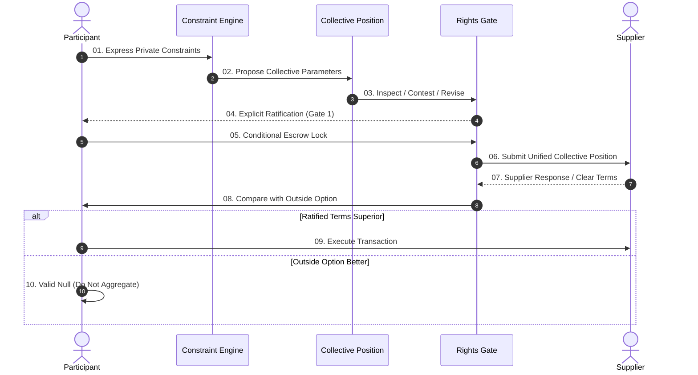

# DC2SC Diagram Library Specification (diagrams.md)

This library catalogs the 6 foundational diagrammatic archetypes used across the DC2SC research platform, GOLIAF stress-test environment, and working paper series.

---

## 1. Archetype 01: Sequence Diagram & Continuous Rights Gates

Used to model the 11-step constitutional sequence from private intent to conditional market ratification.



---

## 2. Archetype 02: Decision Journey Map (GOLIAF 8-Stage Flow)

Used in GOLIAF travel stress-testing to map variance, perishability, and multi-leg cascade points.

```text
[01. Aspiration] ──→ [02. Scenario] ──→ [03. Constraints] ──→ [04. Search]
       │                    │                  │                   │
  (Budget/Dates)       (Household)        (Non-Averagable)    (Dispersion Trap)
       │                    │                  │                   │
       ▼                    ▼                  ▼                   ▼
[05. Comparison] ──→ [06. Decision] ──→ [07. Escrow] ──→ [08. Execution / Fallback]
```

---

## 3. Archetype 03: Asymmetric Network Topology (Market Isolation)

Visualizes the structural gap between atomized buyer search sessions and consolidated supplier dynamic yield algorithms.

- **Isolated Sessions:** $N$ uncoordinated nodes interacting unilaterally with a centralized platform matching engine.
- **Collective Market Position:** A bounded coalition forming an explicit demand vector with contestability and zero-penalty exit floors.

---

## 4. Archetype 04: Constraint Classification Matrix (Shared vs. Individual)

| Potentially Discussable & Poolable | Strictly Individual / Non-Negotiable Floor |
| :--- | :--- |
| • Broad Destination Region / Corridor | • Accessibility & Mobility Requirements |
| • Flexible Date Windows ($\pm 3$ days) | • Medical & Dietary Safety Needs |
| • Target Budget Bracket | • Visa & Jurisdictional Constraints |
| • General Accommodation Tier | • Household & Child Safety Thresholds |
| • Minimum Service Rating Benchmark | • Irreversible Cancellation Tolerance |

---

## 5. Archetype 05: Economic Invariant & Pareto Curve

Models the asymptotic decay of buyer bargaining power as superficial product catalog dispersion increases ($\lim_{|\mathcal{C}|\to\infty} \mathbb{E}[\text{Voice}] \to 0$) alongside coalition welfare recovery under ZK-Escrow.

---

## 6. Archetype 06: Game-Theoretic Payoff Tree (ZK-Escrow Quorum)

Evaluates participant fallback utility under three terminal states:
1. **Successful Ratification:** $\Delta U(\mathbf{x}_{\text{coll}}, \mathbf{x}_{\text{out}}) > 0$.
2. **Valid Non-Aggregation (Null Result):** $\mathbf{1}_{\{\text{exit}\}} \cdot 0$ (Zero penalty, outside option preserved).
3. **Coerced Lock-in (Failure Mode FAIL-04):** Monotonic decay of buyer surplus due to unconditioned wait times.
